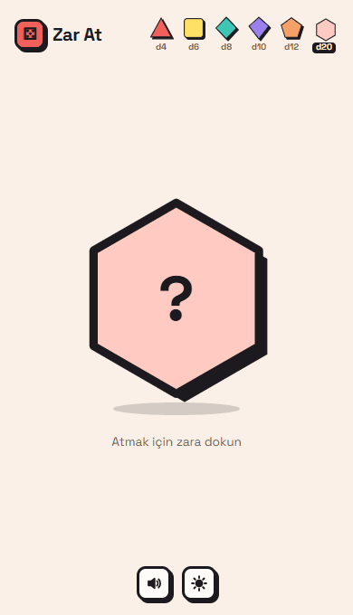
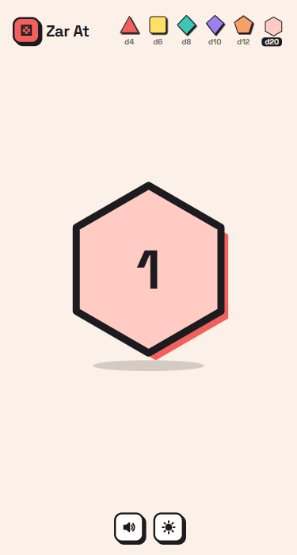
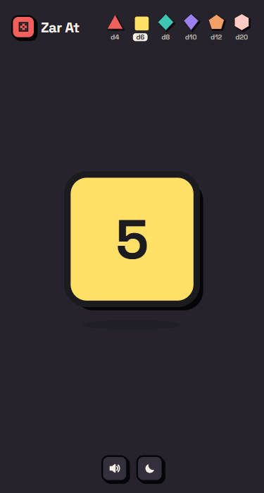

# Zar At · Dice Roller

  
  
  
  

<a href="#-english"><b>🇬🇧 English</b></a> · <a href="#-türkçe"><b>🇹🇷 Türkçe</b></a>

 

<table align="center">
  <tr>
    <td align="center" width="25%"> <b>6 dice</b> d4 → d20</td>
    <td align="center" width="25%"> <b>Shake to roll</b> phone motion</td>
    <td align="center" width="25%"> <b>Critical hits</b> confetti &amp; shake</td>
    <td align="center" width="25%"> <b>Light / dark</b> follows your system</td>
  </tr>
</table>

##  Demo

  
  &nbsp;&nbsp;
  
  
   
  Recorded from the real page · <a href="https://huseyinbaranisik.github.io/zar/">try it yourself</a>

---

## 🇬🇧 English

A simple, **Neo Brutalism**-styled dice roller that works on both phone and desktop. It supports d4, d6, d8, d10, d12 and d20 dice, and you can also roll by shaking your phone.

###  Features

| | |
| :--- | :--- |
| 🎯 **Clean UI** | Tiny dice icons top right, just the die in the middle — tap the die to roll |
| 🔷 **Real shapes** | Every die spins, bounces and lands in its own silhouette: d4 triangle, d6 square, d8 diamond, d10 kite, d12 pentagon, d20 hexagon |
| 📳 **More ways to roll** | Space / Enter, or shake your phone (on iOS, permission is asked on the first tap) |
| 🎉 **Critical results** | Highest value → confetti + green shadow · a 1 → shake + red shadow |
| 🎲 **Fair randomness** | Unbiased rolls with `crypto.getRandomValues` |
| 🔊 **Code-generated sound** | Web Audio effects with no audio files: dice rattle, click, celebration, failure — can be muted |
| 🌗 **Light / dark theme** | Follows your system theme on first visit |
| ♿ **Accessible** | `prefers-reduced-motion` support; die type, theme and sound choice are remembered |

###  Run it

It is a single `index.html` file — no build step, no dependencies. Open it in a browser, or play the live version:
**https://huseyinbaranisik.github.io/zar/**

---

## 🇹🇷 Türkçe

**Neo Brutalism** tasarımlı, telefonda ve bilgisayarda çalışan basit bir zar atma sitesi. d4, d6, d8, d10, d12 ve d20 zarlarını destekler; telefonu sallayarak da atılabilir.

###  Özellikler

| | |
| :--- | :--- |
| 🎯 **Sade arayüz** | Sağ üstte minik zar ikonları, ortada sadece zar — zara dokun, at |
| 🔷 **Gerçek şekiller** | Her zar kendi silüetinde döner, zıplar ve sonuca oturur: d4 üçgen, d6 kare, d8 eşkenar dörtgen, d10 uçurtma, d12 beşgen, d20 altıgen |
| 📳 **Farklı atış yolları** | Boşluk / Enter ya da telefonu sallamak (iOS'ta izin zara ilk dokunuşta istenir) |
| 🎉 **Kritik sonuçlar** | En yüksek değerde konfeti + yeşil gölge · 1 gelince sarsılma + kırmızı gölge |
| 🎲 **Adil rastgelelik** | `crypto.getRandomValues` ile sapmasız sonuç |
| 🔊 **Kodda üretilen ses** | Ses dosyası yok, Web Audio ile: zar takırtısı, klik, kutlama, başarısızlık — kapatılabilir |
| 🌗 **Açık / karanlık tema** | İlk açılışta sistem temasına uyar |
| ♿ **Erişilebilir** | `prefers-reduced-motion` desteği; zar tipi, tema ve ses tercihi hatırlanır |

###  Çalıştırma

Tek bir `index.html` dosyası; build adımı ya da bağımlılık yok. Dosyayı tarayıcıda açman yeterli, ya da canlı sürümü oyna:
**https://huseyinbaranisik.github.io/zar/**

 

  
  Made by <a href="https://github.com/huseyinbaranisik">Hüseyin Baran Işık</a> · Animated emojis: <a href="https://github.com/Tarikul-Islam-Anik/Animated-Fluent-Emojis">Animated Fluent Emojis</a>

