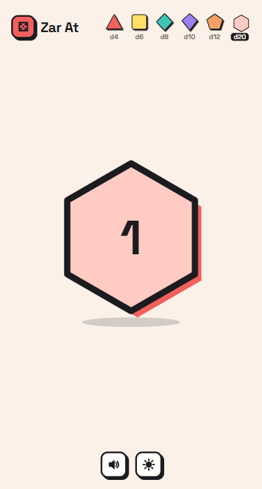
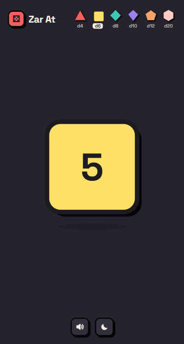

# <p align="center">⚄ ZAR AT</p>
## <p align="center">A Neo Brutalist Dice Roller for Phone and Desktop</p>

<p align="center">
  
  
  
  
</p>

<p align="center">
  <a href="https://huseyinbaranisik.github.io/zar/">
    
  </a>
</p>

<p align="center">
  <a href="#-english"><b>🇬🇧 English</b></a> · <a href="#-türkçe"><b>🇹🇷 Türkçe</b></a>
</p>

<p align="center">
  
  
</p>

---

## 🇬🇧 English

### 📝 About the Project
**Zar At** ("Roll the Die") is a simple dice-rolling website with a **Neo Brutalism** design that works on both phones and computers. It supports **d4, d6, d8, d10, d12 and d20** dice, and you can also roll by shaking your phone. The whole app is a single `index.html` file with no build step and no dependencies.

**Live:** https://huseyinbaranisik.github.io/zar/

### 🌟 Key Features
* 🎲 **Minimal interface:** Tiny dice icons in the top right, only the die in the middle. Tap the die to roll.
* 🔷 **A shape for every die:** d4 triangle, d6 square, d8 diamond, d10 kite, d12 pentagon, d20 hexagon. Each one spins, bounces and lands on the result.
* 📱 **Many ways to roll:** Tap, **Space** / **Enter**, or shake the phone (on iOS, permission is asked on the first tap).
* 🎉 **Critical results:** Confetti and a green shadow on the highest value; a shake and a red shadow on a 1.
* 🔐 **Fair randomness:** Unbiased numbers from `crypto.getRandomValues` (rejection sampling, no modulo bias).
* 🔊 **Generated sounds:** Effects made in code with the Web Audio API, no audio files: dice rattle, button click, a fanfare on the highest value and a fail sound on a 1. Can be muted.
* 🌗 **Light / dark theme:** Follows the system theme on first visit.
* ♿ **Accessibility:** `prefers-reduced-motion` support, arrow-key navigation in the dice picker and screen-reader announcements of each result.
* 💾 **Remembers you:** Die type, theme and sound preference are saved in `localStorage`.

### ⌨️ Controls

| Action | Control |
| :--- | :--- |
| Roll | Tap / click the die, **Space**, **Enter** or shake the phone |
| Change die | Click an icon in the top right, or use the arrow keys in the picker |
| Theme / sound | Buttons in the bottom bar |

### 🛠️ Tech Stack

| Component | Technology | Role |
| :--- | :--- | :--- |
| **Structure** | HTML5 + inline SVG | Page and die shapes |
| **Style** | CSS3 | Neo Brutalism look, animations, themes |
| **Logic** | Vanilla JavaScript | Rolling, preferences, shake detection |
| **Sound** | Web Audio API | Code-generated effects |
| **Randomness** | Web Crypto API | Unbiased results |

### 💻 Running
A single `index.html` file: just open it in a browser. Or use the live version above.

```bash
git clone https://github.com/huseyinbaranisik/zar.git
cd zar
# open index.html in your browser
```

> Shaking to roll needs a secure context (HTTPS) on phones, so use the live site to try it.

---

## 🇹🇷 Türkçe

### 📝 Proje Hakkında
**Zar At**, **Neo Brutalism** tasarımlı, telefonda ve bilgisayarda çalışan basit bir zar atma sitesidir. **d4, d6, d8, d10, d12 ve d20** zarlarını destekler; telefonu sallayarak da atılabilir. Uygulamanın tamamı tek bir `index.html` dosyasıdır; build adımı ya da bağımlılık yoktur.

**Canlı:** https://huseyinbaranisik.github.io/zar/

### 🌟 Temel Özellikler
* 🎲 **Sade Arayüz:** Sağ üstte minik zar ikonları, ortada sadece zar. Zara dokun, at.
* 🔷 **Her Zara Kendi Şekli:** d4 üçgen, d6 kare, d8 eşkenar dörtgen, d10 uçurtma, d12 beşgen, d20 altıgen. Her biri döner, zıplar ve sonuca oturur.
* 📱 **Birçok Atma Yolu:** Dokunma, **Boşluk** / **Enter** ya da telefonu sallama (iOS'ta izin zara ilk dokunuşta istenir).
* 🎉 **Kritik Sonuçlar:** En yüksek değerde konfeti ve yeşil gölge; 1 gelince sarsılma ve kırmızı gölge.
* 🔐 **Adil Rastgelelik:** `crypto.getRandomValues` ile sapmasız sayılar (reddetme örneklemesi, mod sapması yok).
* 🔊 **Kodda Üretilen Sesler:** Ses dosyası olmadan Web Audio API ile üretilen efektler: zar takırtısı, buton klik sesi, en yüksek sayıda kutlama, 1 gelince başarısızlık sesi. Kapatılabilir.
* 🌗 **Açık / Karanlık Tema:** İlk açılışta sistem temasına uyar.
* ♿ **Erişilebilirlik:** `prefers-reduced-motion` desteği, zar seçicide ok tuşlarıyla gezinme ve her sonucun ekran okuyucuya bildirilmesi.
* 💾 **Tercihleri Hatırlar:** Zar tipi, tema ve ses tercihi `localStorage`'da saklanır.

### ⌨️ Kontroller

| Eylem | Kontrol |
| :--- | :--- |
| Zar atma | Zara dokun / tıkla, **Boşluk**, **Enter** ya da telefonu salla |
| Zar değiştirme | Sağ üstteki ikona tıkla ya da seçicide ok tuşlarını kullan |
| Tema / ses | Alt çubuktaki butonlar |

### 🛠️ Teknoloji Yığını

| Bileşen | Teknoloji | Görevi |
| :--- | :--- | :--- |
| **Yapı** | HTML5 + satır içi SVG | Sayfa ve zar şekilleri |
| **Stil** | CSS3 | Neo Brutalism görünüm, animasyonlar, temalar |
| **Mantık** | Saf JavaScript | Zar atma, tercihler, sallama algılama |
| **Ses** | Web Audio API | Kodda üretilen efektler |
| **Rastgelelik** | Web Crypto API | Sapmasız sonuçlar |

### 💻 Çalıştırma
Tek bir `index.html` dosyası: tarayıcıda açman yeterli. Ya da yukarıdaki canlı sürümü kullan.

```bash
git clone https://github.com/huseyinbaranisik/zar.git
cd zar
# index.html dosyasını tarayıcıda aç
```

> Telefonda sallayarak atma güvenli bağlantı (HTTPS) ister; denemek için canlı siteyi kullan.
